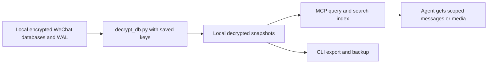

# Architecture

Python modules stay at the root to preserve imports, script entry points and
existing `config.json` paths. There is one MCP server, `mcp_server.py`, and the
`wechat` CLI dispatches export, decrypt, backup, Moments and Favorites commands.
Detailed documentation lives in `docs/`; coding-agent instructions in `AGENTS.md`.

| Area | Source | Responsibility |
| --- | --- | --- |
| MCP | `mcp_server.py` | Tool registration, visibility policy, search index, freshness and formatting |
| CLI and export | `wechat`, `export_chat.py`, `formatters.py` | Dispatch and txt/md/html/json/csv exports |
| Configuration | `config.py`, `config.example.json` | Account detection, paths and owner-only output permissions |
| Decryption | `decrypt_db.py`, `find_all_keys_macos.c` | Key discovery, HMAC checks, incremental snapshots and committed WAL frames |
| Messages | `chats.py`, `msg_parse.py` | Chat/contact discovery, message parsing and IDs |
| Media | `image_decode.py`, `media_decode.py`, `emoticon.py` | Images, SILK audio, local videos and sticker retrieval |
| Social data | `moments.py`, `favorites.py`, `social_common.py` | Local Moments and Favorites parsing/export |
| Backup | `backup.py`, `launcher/` | Saved-key backup and macOS scheduled launcher |
| Setup | `setup.sh`, `requirements.txt` | Environment, scanner compilation and interactive app-copy setup |
| Checks | `tests/`, `.github/workflows/ci.yml` | Synthetic fixtures, lint, C builds and shell checks |

## Data flow

Interactive decryption can invoke the scanner when keys are missing or stale.
MCP refresh and unattended backup use saved keys and never invoke it. Reading
source files can produce local snapshots, indexes, decoded media and audit logs;
it does not write to the original WeChat databases or send messages.

## Local files excluded from Git

`config.json`, `all_keys.json`, `wechat_key.txt`, `decrypted/`, `decoded_images/`,
`export/`, `logs/`, compiled scanner/launcher artifacts and `venv/` are local
state. Their contents must not become source fixtures, docs examples or CI
artifacts. The shared synthetic fixtures in `tests/` model messages without
requiring a real account.
